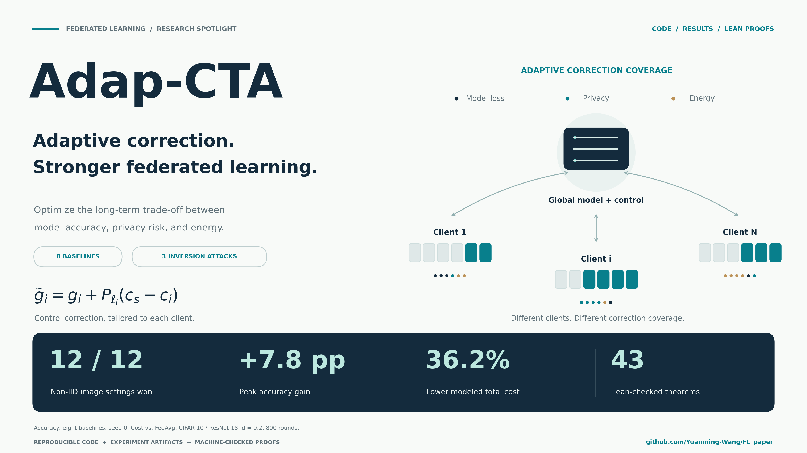
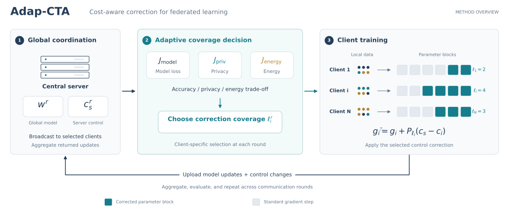
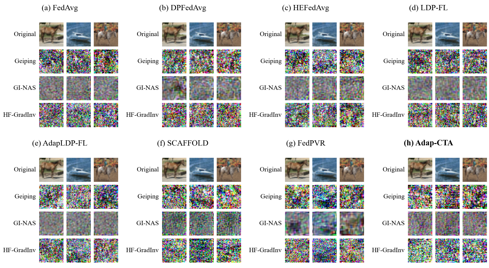

<div align="center">

# Adap-CTA

### Efficient Privacy-preserving Federated Learning via Long-term Cost Optimization

**Adaptive correction. Stronger learning under heterogeneity. Lower long-term cost.**


[](formal/lean-toolchain)
[](formal/verification.json)
[](results)

[Highlights](#highlights) · [Method](#method-overview) · [Results](#experimental-results) · [Quick start](#quick-start) · [Reproduce](#reproduce-the-experiments) · [Lean proofs](#lean-formal-verification)

</div>

<p align="center">
  
</p>

<p align="center">
  <a href="assets/adapcta_promo.png">High-resolution graphic</a> · <a href="assets/adapcta_promo.svg">Vector graphic</a>
</p>

**Adap-CTA** is an adaptive correction term addition strategy for federated learning. It makes correction coverage a client decision and optimizes the cumulative trade-off among model accuracy loss, privacy risk, and energy cost. This repository provides the method implementation, training artifacts, gradient inversion experiments, and a reproducible Lean formalization.

## Highlights

| Heterogeneous image learning | Overall image accuracy | Largest accuracy gain | Lower modeled total cost | Fewer rounds to target |
|:---:|:---:|:---:|:---:|:---:|
| **12 / 12** Non-IID settings | **15 / 16** settings | **+7.8 pp** | **36.2%** | **34.9%** |

- **Strong accuracy across data heterogeneity.** Adap-CTA achieves the highest final global-model accuracy in every evaluated Non-IID image configuration and 15 of the 16 image configurations overall, against eight baselines.
- **Better accuracy–cost trade-off.** On CIFAR-10 / ResNet-18 with `d = 0.2`, the modeled 800-round total cost is **9,911.97**, compared with **15,546.08** for FedAvg. Adap-CTA reaches 60% accuracy at **round 515**, compared with **round 791** for SCAFFOLD.
- **Reduced pixel reconstruction fidelity.** In the common observed-upload benchmark, Adap-CTA yields higher reconstruction MSE and lower PSNR and SSIM than FedAvg under **Geiping, GI-NAS, and HF-GradInv**.
- **Theory accompanied by executable proofs.** The repository includes **43 Lean-checked theorems**, a pinned dependency lockfile, an axiom auditor, and the verification transcript.

Accuracy figures refer to the recorded final round, with 800 communication rounds and seed 0. Cost is the recorded sum of model-loss, privacy, and energy proxies. The cost and communication-round percentages above refer to the stated CIFAR-10 / ResNet-18 setting. Complete results, including Shakespeare, are in [the training summary](results/training/summary.csv).

## Method overview

Adap-CTA adapts how much of the local model receives a control correction. Clients select correction coverage through the cost-based decision rule, train with the selected correction, and return their updates for aggregation. The multi-stage cost formulation connects the learning decision to accuracy, privacy risk, and energy expenditure.

<p align="center">
  
</p>

**One adaptive federated round.** The server coordinates the global state; correction coverage balances model-loss, privacy, and energy costs; each client applies the selected control correction before returning its update. Teal blocks indicate corrected parameter blocks. The [vector figure](assets/adapcta_overview.svg) can be regenerated with `python scripts/plot_method_overview.py`.

For the standard correction step, a client's gradient has the form

$$
\widetilde g_i = g_i + P_{\ell_i}(c_s-c_i),
$$

where $P_{\ell_i}$ selects the corrected parameter blocks, $c_s$ is the server control, and $c_i$ is the client control. Adapting $\ell_i$ makes correction coverage part of the optimization decision.

| Core component | Implementation |
|---|---|
| Adaptive server and client decisions | [`saveserver.py`](safe_FL/system/flcore/servers/saveserver.py) |
| Client training and control updates | [`save_client.py`](safe_FL/system/flcore/clients/save_client.py) |
| Selected correction optimizer | [`S_SCAFFOLDOptimizer`](safe_FL/system/flcore/optimizers/fedoptimizer.py) |
| Training entry point | [`main.py`](safe_FL/system/main.py) |
| Formal companion | [`AdapCTA_Formal.lean`](formal/AdapCTA_Formal.lean) |

## Experimental results

### Final global-model accuracy

The image benchmark covers **CIFAR-10 and CIFAR-100**, **ResNet-18 and VGG-11**, and **Dirichlet `d = 0.2, 0.5, 0.8` plus IID**. The table shows representative comparisons against the strongest baseline in each setting. Accuracy is a percentage; gains are percentage points computed before rounding.

| Dataset | Model | Setting | Adap-CTA | Strongest baseline | Gain (pp) |
|---|---|---|---:|---:|---:|
| CIFAR-10 | ResNet-18 | d = 0.2 | **65.82** | 59.93 (SCAFFOLD) | **+5.89** |
| CIFAR-10 | VGG-11 | d = 0.2 | **86.74** | 79.94 (SCAFFOLD) | **+6.79** |
| CIFAR-10 | VGG-11 | d = 0.5 | **83.01** | 75.19 (SCAFFOLD) | **+7.83** |
| CIFAR-100 | VGG-11 | d = 0.2 | **44.60** | 39.87 (SCAFFOLD) | **+4.73** |

The eight comparison methods are **FedAvg, DPFedAvg, HEFedAvg, LDP-FL, AdapLDP-FL, SCAFFOLD, FedMut, and FedPVR**. The artifact collection contains **180 complete training curves and logs across 18 dataset/model/distribution configurations**, with additional historical FedCEO runs included alongside the eight-baseline benchmark. Each H5 file records its implementation and protocol metadata; the reported results refer to those recorded implementations and settings.

**Explore:** [Training summary](results/training/summary.csv) · [Curves and logs](results/training/main_table) · [Training provenance](results/training/provenance)

### Gradient inversion evaluation

Eight methods are evaluated under three attacks, giving **24 complete attack cases**. The benchmark uses the same 64 reference images and labels, round-800 model states, seed 0, batch-mode BatchNorm, and matching settings across methods within each attack. Saved reports and tensors support independent metric replay.

The following comparison uses **higher MSE** and **lower PSNR / SSIM** to indicate lower pixel reconstruction fidelity:

| Attack | FedAvg MSE ↑ | Adap-CTA MSE ↑ | FedAvg PSNR ↓ | Adap-CTA PSNR ↓ | FedAvg SSIM ↓ | Adap-CTA SSIM ↓ |
|---|---:|---:|---:|---:|---:|---:|
| Geiping | 0.1243 | **0.1370** | 9.18 | **8.72** | 0.1549 | **0.1517** |
| GI-NAS | 0.0632 | **0.0662** | 12.36 | **12.11** | 0.2605 | **0.2436** |
| HF-GradInv | 0.1227 | **0.1402** | 9.22 | **8.62** | 0.1594 | **0.1499** |

<div align="center">

</div>

The figure uses identical reference samples and column order for all methods. Full-batch metrics, including recognition rate and classifier confidence, are available in [the attack summary](results/attacks/summary.csv); the replay report checks **1,536 reference/reconstruction pairs**.

**Explore:** [Attack summary](results/attacks/summary.csv) · [Per-method reconstructions](results/attacks/reconstructions) · [Verification report](results/attacks/verification.json) · [Figure PDF](results/attacks/figures/Attack_reconstructions.pdf)

## Quick start

### 1. Get the code and experiment artifacts

Install [Git LFS](https://git-lfs.com/) before cloning so that model states, H5 files, and dataset archives are downloaded as real files.

```bash
git lfs install
git clone https://github.com/Yuanming-Wang/FL_paper.git
cd FL_paper
git lfs pull
```

### 2. Prepare Python

Python **3.10** is used for the published checks. Install a PyTorch/torchvision build appropriate for your accelerator, then install the remaining project dependencies:

```bash
python -m venv .venv
source .venv/bin/activate
python -m pip install -r requirements.txt
```

On Windows PowerShell, activate with `.venv\Scripts\Activate.ps1`. Result verification and plotting run on CPU. Training and fresh attack optimization support the PyTorch accelerator environment; the uniform attack runner uses the `cuda` device API.

### 3. Verify the published results

Run these commands from the repository root:

```bash
python safe_FL/scripts/summarize_training.py --check
python safe_FL/scripts/plot_training_results.py --all --check
python safe_FL/scripts/plot_paper_figures.py --check
python scripts/verify_attack_results.py
```

These checks validate **180 training records** and replay **all 24 attack cases**, including source tensors, reference pixels, upload protocol, sample assignment, and numerical scores. They use the published artifacts directly, so downloading CIFAR is unnecessary for this step.

## Reproduce the experiments

### Regenerate the figures

```bash
python safe_FL/scripts/plot_paper_figures.py
python scripts/plot_attack_reconstructions.py
```

Training figures are written to `results/training/figures/paper/`. The attack figure and its provenance are written to `results/attacks/figures/` and `results/attacks/figure_provenance.json`.

### Rerun all three attacks on Adap-CTA

The saved upload bundles include the victim model state and reference batch. Use a new output directory for fresh optimization:

```bash
python safe_FL/scripts/run_privacy_benchmark.py --method Adap-CTA --captures results/attacks/captures --output-root results/attacks/reruns --geiping-control results/attacks/controls/geiping.json --ginas-control results/attacks/controls/gi_nas.json --hf-control results/attacks/controls/hf_gradinv.json --device 0
```

This runs **Geiping: 4,800 iterations**, **GI-NAS: 5,000 search candidates and 30,000 optimization iterations**, and **HF-GradInv: the validated 3,000-iteration, four-stage schedule**. To evaluate another method, replace `Adap-CTA` with `FedAvg`, `DPFedAvg`, `HEFedAvg`, `LDP-FL`, `AdapLDP-FL`, `SCAFFOLD`, or `FedPVR`. Select a single attack with `--attacks geiping`, `--attacks gi_nas`, or `--attacks hf_gradinv`.

### Prepare the exact CIFAR-10 benchmark partition

The recovery manifest records image hashes and labels for all 100 clients. This command downloads public CIFAR-10, reconstructs the recorded `d = 0.2` partition, and verifies the normalized tensors:

```bash
python safe_FL/scripts/rebuild_attack_data.py --manifest results/attacks/provenance/client_partitions.json --output-root safe_FL/dataset --public-root data/public
```

Shakespeare partitions are included via Git LFS. Additional CIFAR partition experiments can be prepared with [`prepare_cifar_partitions.py`](safe_FL/dataset/prepare_cifar_partitions.py) from the extracted public CIFAR archives. Training reads `safe_FL/dataset/` by default; set `FL_DATA_ROOT` to use another dataset directory.

### Train Adap-CTA

Example: CIFAR-10 / ResNet-18, `d = 0.2`, 100 clients, 10% participation, 800 rounds, batch size 64, five local epochs, and learning rate 0.01:

```bash
python safe_FL/system/main.py --algorithm Adap-CTA --dataset Cifar10 --model resnet --num_classes 10 --NIID 0.2 --num_clients 100 --join_ratio 0.1 --global_rounds 800 --local_epochs 5 --batch_size 64 --local_learning_rate 0.01 --total_layer 62 --target_accuracy 0.6 --seed 0 --device cuda --device_id 0 --goal AdapCTA_Cifar10_ResNet18_d0p2
```

This command trains the current release. New curves, checkpoints, models, and round metrics are written under `results/training/`; the published curves retain their original source/data fingerprints and per-run settings. Consult the H5 metadata and [provenance records](results/training/provenance) when matching a historical run.

Run the implementation checks with:

```bash
python safe_FL/system/check_adaptive_protocol.py
python safe_FL/scripts/check_training_protocol.py
python safe_FL/scripts/check_learning_rate.py
```

### Capture a fresh upload benchmark

After preparing the exact CIFAR-10 partition, the archived inputs and RNG state can be used to regenerate the selected-client uploads through each method's actual client training implementation:

```bash
python safe_FL/scripts/capture_attack_benchmark.py --inputs results/attacks/inputs --rng-state results/attacks/common/rng_state.pt --reference-bundle results/attacks/common/reference.pt --data-root safe_FL/dataset --output-dir results/attacks/capture_reruns
```

To package newly trained round-800 server checkpoints, use [`prepare_attack_inputs.py`](safe_FL/scripts/prepare_attack_inputs.py). Checkpoints must include the required server and client control states; the packager records control availability in its manifest.

## Lean formal verification

The formal companion is a standalone Lake project in [`formal/`](formal). Its **43 theorem declarations** cover:

| Component | Formalized results |
|---|---|
| Cost-game analysis | Endpoint derivatives, analytical threshold, potential structure, equilibrium existence and uniqueness, strict improvement paths, and additive tail-cost equilibria |
| Control mechanism | Control-offset invariants, projected correction identities, local-trace expansion, and control refresh |
| Convergence analysis | Drift absorption, coefficient bounds, convex/nonconvex Lyapunov closure, finite-round telescoping, and tolerance choices |
| Correction coverage and reconstruction | Nested-mask residual energy, full-correction residual cancellation, and gradient-ratio reconstruction identities |

The convergence declarations encode their one-round estimates as explicit theorem hypotheses. All 43 declarations pass the Lean checker and printed axiom audit; the recorded dependencies are the standard `propext`, `Classical.choice`, and `Quot.sound` axioms.

| Reproducibility item | Pinned value / file |
|---|---|
| Lean | **4.19.0** — [`lean-toolchain`](formal/lean-toolchain) |
| mathlib | **v4.19.0**, commit `c44e0c8ee63ca166450922a373c7409c5d26b00b` |
| Transitive dependencies | [`lake-manifest.json`](formal/lake-manifest.json) |
| Proof source | [`AdapCTA_Formal.lean`](formal/AdapCTA_Formal.lean) |
| Re-runnable auditor | [`verify.py`](formal/verify.py) |
| Latest recorded audit | [`verification.json`](formal/verification.json) and [`verification.log`](formal/verification.log) |

Install Lean's [elan toolchain manager](https://github.com/leanprover/elan), then run:

```bash
cd formal
lake exe cache get
lake build
python verify.py
cd ..
```

`verify.py` checks the Lean version, all nine locked dependency revisions, successful compilation, coverage of all theorem audits, and the allowed axiom set. It rejects proof placeholders and custom axiom dependencies, and writes source/configuration hashes alongside the result. The original supplied proof source is preserved byte for byte.

## Repository layout

```text
FL_paper/
├── README.md
├── requirements.txt
├── assets/                       # Method overview in SVG and PNG
├── formal/                       # Lean source, pinned Lake project, and proof audit
├── safe_FL/
│   ├── system/                   # Federated training and attack implementations
│   ├── dataset/                  # Partition preparation and included text partitions
│   ├── scripts/                  # Training, capture, plotting, and protocol utilities
│   └── licenses/                 # Third-party license texts
├── scripts/                      # Attack metric replay and figure generation
└── results/
    ├── training/
    │   ├── main_table/           # Dataset/model/distribution/method curves and logs
    │   ├── summary.csv
    │   └── provenance/
    └── attacks/
        ├── inputs/               # Round-800 model and required control states
        ├── captures/             # Observed uploads and gradient bundles
        ├── common/               # Shared reference batch and RNG state
        ├── controls/             # Validated attack profiles
        ├── reconstructions/      # Per-method, per-attack tensors, grids, and scores
        ├── recovery/             # SCAFFOLD/FedPVR control-state recovery records
        ├── figures/
        ├── summary.csv
        └── verification.json
```

Published training artifact paths and checksums are indexed in [`results/training/summary.csv`](results/training/summary.csv). Machine-specific path labels in archived metadata are represented by `*_path_sha256` digests.

Control-state recovery records are grouped by method under [`results/attacks/recovery`](results/attacks/recovery): `SCAFFOLD/` and `FedPVR/`. Each contains `curves.h5`, `round_metrics.jsonl`, `training.log`, and `setup.log`.

The promotional graphic can be regenerated from the recorded training results and proof audit with `python scripts/plot_promo.py`.

## Acknowledgements

The training code builds on [PFLlib](https://github.com/TsingZ0/PFLlib). The inversion experiments build on the included attack implementations and the [Inverting Gradients](https://github.com/JonasGeiping/invertinggradients) research code; original source headers and [third-party license texts](safe_FL/licenses) are retained. The formal companion uses [Lean](https://github.com/leanprover/lean4) and [mathlib](https://github.com/leanprover-community/mathlib4).
